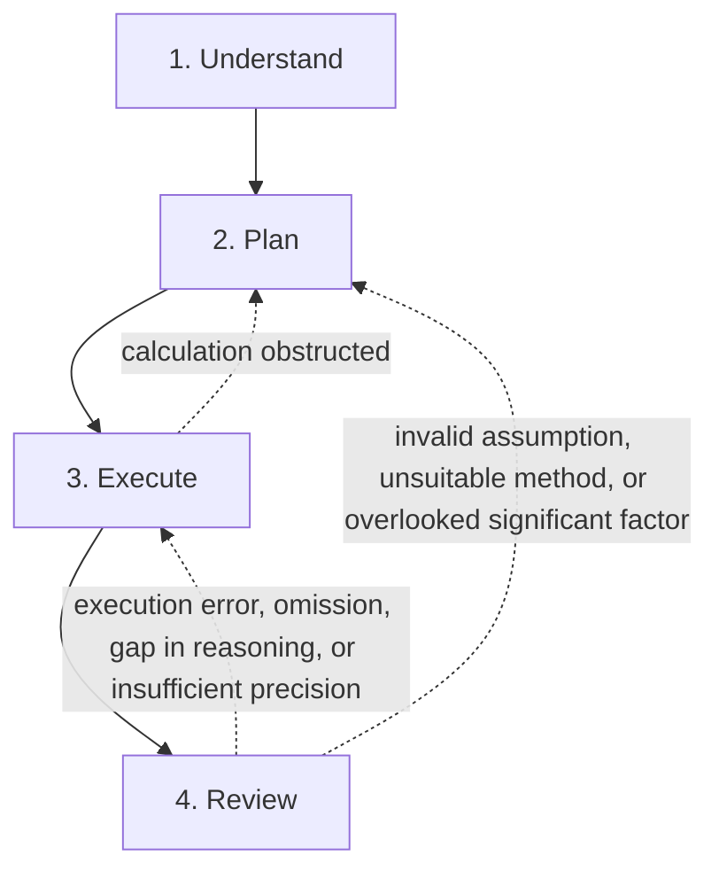

# Researchly

[中文](README.md) | English

> Even with Li Lou’s keen eyesight and Gongshu’s skill, one cannot make true squares and circles without a square and compass. — *Mencius*, “Li Lou I”

A DeepSeek Harness plugin that draws on George Pólya’s *How to Solve It* to guide agents through mathematical and physical research in four stages: understand, plan, execute, and review.

## What it does

This plugin guides the root agent through a strict, four-stage process for mathematical and physical research, aiming to reduce hallucinations and errors. If execution or review reveals a problem, the agent returns one or two stages to reconsider its approach. Only the problem statement and phase completion markers are kept in memory; research notes, summaries, and revision history are not stored.

## The four stages

To investigate a mathematical or physical problem, first establish what is sought, then devise a plan, carry it out, and finally review the result. The four stages are:

1. **Understand (`understand`)** — clarify the problem, distinguish the known from the unknown, examine the conditions, and state the notation conventions.
2. **Plan (`plan`)** — seek connections between the known and the unknown, and use them to devise an approach.
3. **Execute (`execute`)** — follow the plan step by step, checking the reasoning at each step; if an obstruction prevents completing the calculation, return to the planning stage and revise the plan.
4. **Review (`look_back`)** — verify the result, examine special cases, and try an independent derivation by another route.

When a problem requires returning to an earlier stage, call `reopen` before marking the current phase complete. The target phase and all subsequent phases must be completed again. Only the three return paths shown above are allowed; once all four phases are complete, `reopen` can no longer be used. The model decides which phase to return to based on the cause; the tool checks that the transition is allowed and supplies the corresponding guidance.
