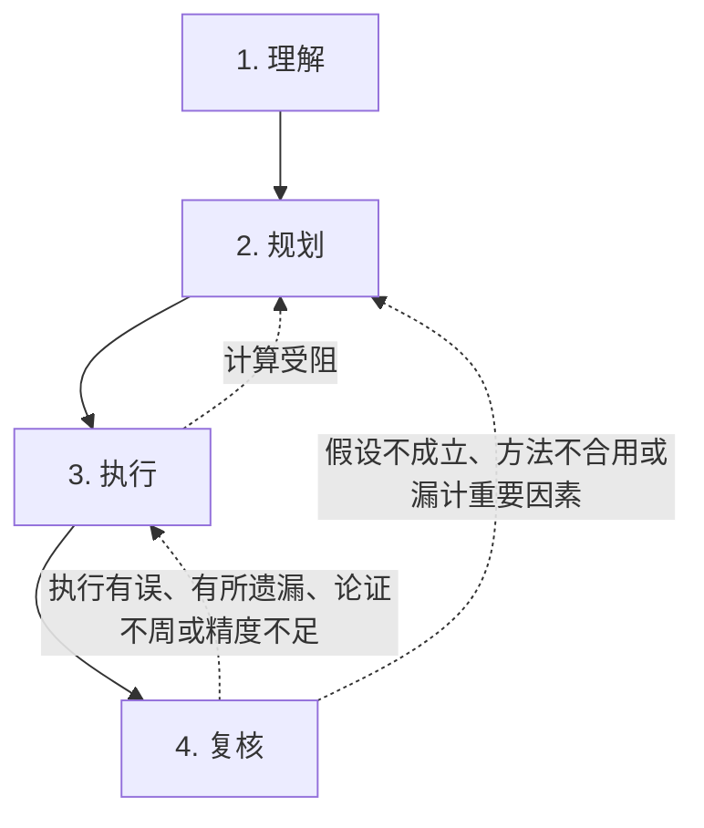

# Researchly

中文 | [English](README.en.md)

> 离娄之明，公输子之巧，不以规矩，不能成方圆。——《孟子·离娄上》

本插件供 DeepSeek Harness 使用，参考 George Pólya 的书 *How to Solve It* 的方法，引导智能体依理解、规划、执行、复核四步研究数学、物理问题。

## 用途

本插件引导主智能体按严格的流程研究数学、物理问题，减轻幻觉，减少错误，依次完成四个阶段；执行或复核时若发现问题，便退回前一步或前两步，重新研究。内存中只保留题目及各阶段是否完成的记录，不保存研究笔记、摘要或历次修订。

## 求解的四个阶段

研究数学、物理问题，先须认清所求为何，继而拟定计划，加以执行，最后复核所得的结果。四步的要点如下：

1. **understand（理解）** — 弄清题意，分辨已知与未知，审察条件，并说明符号约定。
2. **plan（规划）** — 寻求已知与未知之间的联系，据以拟定求解的办法。
3. **execute（执行）** — 依计划逐步进行，随时检查每一步的根据；若计算受阻，不能完成，便退回第二步，重拟计划。
4. **look_back（复核）** — 检验所得的结果，考察特殊情形，并试从另一途径独立推导。

发现问题而须退回时，应在本阶段尚未标为完成之前调用 `reopen`。从退回的阶段起，以下各阶段均须重新完成。退回的途径只限图中三种；四步全部完成以后，便不能再用此法退回。应退至哪一步，由模型按问题的原因决定；工具则检查这一转换是否合乎规定，并换用相应的提示词。
